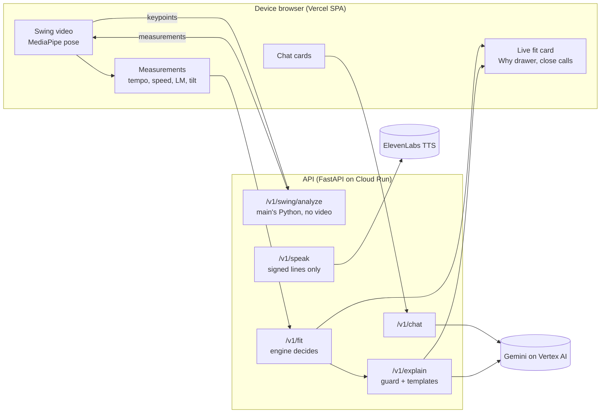

# Takomo Fitter

Iron fitting in the browser for [Takomo Golf](https://takomogolf.com). The golfer chats with a host, can add a swing
video and launch monitor numbers, and gets a Takomo iron spec (head, shaft, length, lie, grip, stock or custom)
with a confidence and the reasons behind every part.

Built at Since AI Hackathon 2026 by team Porokoodarit.

## Why

Buying irons online has a trust gap: a questionnaire guesses, a fitting studio measures. Takomo Fitter aims for
"measured, not guessed" without a studio:

- Every input is tagged **asked**, **measured** or **estimated**, with an uncertainty.
- A **deterministic engine** picks the spec and says how sure it is. Close calls are shown, not hidden.
- An **LLM host** explains the result in plain words. It never picks a value.
- The **swing video never leaves the device.** Only numbers do.

## How it works

User flow: chat with the host (profile cards) -> optional swing video -> optional extra data (launch monitor,
ball-line lie test) -> club pick -> results with "Why?" per part and "Want a surer fit?" next steps.



Request flow:
1. Each step posts a `FitRequest` (answers + measurements) to `POST /v1/fit`.
2. The engine fuses the evidence, runs Takomo's rules, validates against the catalogue and returns a `FitState`:
   per part a value, range, confidence, evidence chain, reason codes and close call.
3. The UI updates the live fit card and shows what changed.
4. `POST /v1/explain` turns the fit state into host lines (LLM, guarded, template fallback).
5. `GET /v1/speak` reads a signed host line aloud when voice is on.

## Technologies used

| Layer | Technology | Used for |
|---|---|---|
| Web UI | React 19, TypeScript, Vite | Single-page app, mobile first |
| Web UI | TanStack Router, TanStack Query | File routes, API calls |
| Web UI | Tailwind CSS 4, shadcn/ui (Radix), lucide-react, sonner | Design system, toasts |
| Web UI | react-hook-form, Zod | Forms, validation |
| Web UI | Lovable | Original UI design (export kept in `frontend/`) |
| On-device vision | MediaPipe Tasks Vision (pose landmarker lite, WASM, self-hosted) | Pose keypoints from the swing video |
| On-device vision | mediabunny (WebCodecs) | Fast in-order frame decode |
| On-device vision | onnxruntime-web (WebGPU, WASM fallback) + SwingTrace YOLO11m, ONNX FP16 | Club head on the down-the-line clip; club tracking bench |
| API | Python 3.12, FastAPI, Uvicorn, Pydantic v2, pydantic-settings | Endpoints, schema, `TAKOMO_*` config |
| API | NumPy, pandas | Engine fusion; main's swing algorithm |
| Swing research | Python, OpenCV, MediaPipe, Ultralytics YOLO | Desktop pipeline the swing algorithm comes from (`app/vision/research`) |
| LLM | Google Gemini via `google-genai`: flash-lite (chat), flash (step lines), pro (final walkthrough) | Host chat and explanations |
| LLM auth | Vertex AI keyless via Application Default Credentials; Gemini API key as fallback | No keys in code or browser |
| Voice | ElevenLabs Flash v2.5 (live); browser speech synthesis as fallback | Host voice |
| Shared contract | JSON Schema generated from Pydantic, TS types via `json-schema-to-typescript` | One fit-state schema for API and web |
| Hosting | Google Cloud Run (europe-north1), Secret Manager, Cloud Logging | API, secrets, logs |
| Hosting | Vercel | Web |
| Containers | Docker, docker compose, nginx | Local full stack, any container host |
| Quality | pytest, ruff, Vitest, Testing Library, ESLint, Prettier | Tests and lint |
| CI | GitHub Actions | API, web, images, linear history, swing code drift |
| Evaluation | Synthetic Takomo lab dataset | Accuracy vs today's fitting rules |

In the repo but not used: Modal GPU stub (`app/vision/modal_app.py`). Not built: server-side save (MongoDB Atlas). Replaced: Supabase (Lovable Cloud).

## Recommendation engine

**The engine decides, the LLM explains.** Every spec part comes from deterministic Python in
`app/api/takomo_api/engine/` (`fusion.py`, `fit.py`, `rules.py`, `catalogue.py`, `validate.py`).

- **Inputs are observations.** Each one is `{value, sd, source, method}`, where source is asked, measured,
  estimated or default. Profile answers carry the bias and spread of self-reports; measurements carry their own error.
- **Fusion.** Sources are combined by inverse-variance weighting, so a precise measurement outweighs a vague
  answer and "nothing known" gives a wide estimate, not a fake exact one. Swing speed, for example:

  | Source | SD |
  |---|---|
  | Launch monitor speed | 1.5 mph |
  | Launch monitor carry -> speed | >= 3 mph |
  | Asked speed (-2 mph bias) | 5 mph |
  | Remembered carry -> speed (-15 yd over-report, loft corrected) | ~5-6 mph |
  | Swing video (pendulum model, not yet validated vs TrackMan) | 12 mph (wider without height) |
  | Typical score -> speed prior | 12 mph |
  | Population prior | 10 mph |

- **Takomo's rules per part.**

  | Part | Driven by |
  |---|---|
  | Head | Skill, speed, priorities (over-92 scorers capped) |
  | Flex | Speed bucket; close call shown with its margin in mph |
  | Material | Graphite for lady/senior flex, women, age 70+ |
  | Shaft model | Flight x tempo |
  | Length | Takomo height table |
  | Lie | Strike / toe-up > ball-line test (lie = -0.65 x tilt + 0.4 deg) > height + wrist-to-floor chart |
  | Grip | Measured hand > glove size > M |
  | Stock or custom | Takomo's stock rule; `STOCK_CLOSE_CALL` when standard is still >= 30 % likely |

- **Flight and tempo are weighed, not overwritten.** The golfer's answer is a prior (right about 70 % of the time),
  the measurement is a likelihood, and the posterior picks the class. Reason codes say when they disagree.
- **Confidence** is the probability that the chosen option is right, per part.
- **Explainability.** `PartState.inputs` is the evidence chain behind each part with each input's weight (the
  "Why?" drawer). `FitState.next_steps` ranks missing inputs by expected confidence gain ("Want a surer fit?").
- The output is checked as buildable against the Takomo catalogue.

Formulas, tuning and open checks: [app/docs/RECOMMENDATION_ENGINE.md](app/docs/RECOMMENDATION_ENGINE.md).

## Video processing

**The video never leaves the device.** The browser turns it into pose keypoints (numbers), and the API runs the
team's own Python swing algorithm on them.

1. **Device:** face-on clip -> MediaPipe pose -> 9 keypoints per frame (head, shoulders, wrists, ankles). No images.
2. **Optional down-the-line clip:** pose + YOLO club head on about 8 still frames before takeaway (box centres only),
   for shaft length.
3. **API `POST /v1/swing/analyze`:** `phase_detector` (swing phases, tempo) and `swing_analytics.calculate_club_speed`
   (+ `calculate_shaft_length_m` with the down-the-line clip). Nothing is stored or logged.
4. **Result:** measurements with SDs go back to the device and into the next `/v1/fit`: backswing and downswing
   seconds (SD 1/fps + 12 ms), video club speed (SD 12 mph with height known, wider without; only from real-time sample rates >= 100 fps), shaft length.
5. **Fallback:** if the API is off or can't read the swing, the device times the tempo itself
   (`app/web/src/lib/pose/tempo.ts`). `VITE_SWING_SERVER=off` skips the API. The result screen shows who read the
   swing and every data point.

Capture: a framing guide is laid over the camera; face-on, whole body and ball in view, 7-iron. Slow-motion clips
work: the golfer picks the video speed (1x, 4x, 8x) so tempo is in real seconds. Every video step can be skipped.

**One algorithm, synced from its source.** The swing code is a verbatim copy of the research files in
`app/api/takomo_api/swing/upstream/`; the commit it came from is in `upstream/UPSTREAM`. App-side fixes live only
in `swing/measure.py` (real fps and slow-mo, real aspect ratio, gap-filled wrists, skip speed without a downswing).
Its `categorize_*` / `predict_fitting` rules are not used: the engine decides. `app/vision/sync-main.sh` re-syncs
the copies and CI warns when they drift. Details: [app/vision/research/README.md](app/vision/research/README.md).

Code: device `app/web/src/lib/pose/`, `lib/swing-server.ts`, `lib/swing-dtl.ts`, `hooks/use-swing-upload.ts`;
API `app/api/takomo_api/swing/`.

## LLM integration

**Gemini words things, it never decides.** Every LLM output is validated, guarded and has a deterministic fallback.
Code: `app/api/takomo_api/llm/` (`gemini.py`, `registry.py`, `chat.py`, `explain.py`), prompts in
`app/api/takomo_api/prompts/`.

| Role | Endpoint | Default model | Time budget |
|---|---|---|---|
| `chat` (host profiling) | `POST /v1/chat` | `gemini-flash-lite-latest`, retry on `gemini-flash-latest` | 12 s per turn, 7 s first try |
| `step_line` | `POST /v1/explain` | `gemini-flash-latest` | 6 s |
| `final_walkthrough` | `POST /v1/explain` | `gemini-pro-latest` | 12 s |

- **Auth:** Vertex AI keyless via Application Default Credentials on Cloud Run (`TAKOMO_GEMINI_VERTEX=true` +
  `TAKOMO_GCP_PROJECT`, location `global` by default; service account with `roles/aiplatform.user`). Fallback: Gemini API key (`TAKOMO_GEMINI_API_KEY`, from Secret Manager).
- **What the model sees.** Explain: labels, confidence, reason codes and close calls of a fit state the server
  rebuilds itself from the inputs, plus each reason's few parameters (e.g. carry said/used, own loft, a close call's
  margin); never client state, never the full inputs. The guard keeps mph/yd numbers out of what it writes. Chat: profile, answered cards and the
  last 6 turns as plain lines.
- **Guardrails.** JSON output -> Pydantic validation -> spec-match guard (blocks mph/yd numbers, wrong flex or grip,
  stock/custom flips, shaft names, sign flips) -> on any failure or timeout, reason-code templates. Each reply says
  `source: llm | template`. The system prompt treats the fit state as data, not instructions.
- **Reliability.** One retry on the fallback model when enough time is left, backoff only on 429/503, over-long
  labels clipped instead of dropping the turn, startup warm-up, one log line per call (model, ms, tokens). Chat only
  asks for a Yes/No confirm after the summary card or a new value, never after a golfer question. Latency bench:
  `python -m eval.llm_bench`.
- **Provider-agnostic.** A thin `LLMProvider` adapter maps roles to models via `TAKOMO_LLM_*`. A hidden switch panel
  (`?demo=1`) needs `TAKOMO_DEMO_MODE=true`, an `X-Demo-Token` and a model allowlist.
- **Voice (live).** ElevenLabs Flash v2.5. The API signs each host line (HMAC `audio_token`); `GET /v1/speak` streams
  mp3 only for signed lines, so it is no open TTS proxy. Memory cache, rate limit and daily character cap. The opening
  greeting and host banners are spoken too. Web: `VITE_VOICE=on|off`, mute toggle, captions always on, no browser speech fallback.
- **Abuse limits** per client IP, in memory per instance: explain 30/min, chat 120/min, swing 60/min, voice 30/min
  (cache misses only); 64,000-byte body cap (600,000 for swing keypoints).

## Data and privacy

| Data | Leaves the device? | Kept |
|---|---|---|
| Swing video, ball-line photo | No | Gone when the page closes |
| Swing pose keypoints | To the API once per video | Not stored or logged |
| Answers, timings, launch monitor numbers | To the API per request | This browser, 30 days or "Delete my data" |
| Chat text | To the API, then Gemini (last 6 turns) | This browser, 30 days |
| Host lines | To ElevenLabs when voice is on | API memory cache |

No accounts. API keys live only on the server. Every upload has a skip path. Synthetic lab data is never shown as
real golfers. Full table: [app/docs/DATA_PRIVACY.md](app/docs/DATA_PRIVACY.md).

## Accuracy

Synthetic Takomo lab data (dev split, 3000 golfers, never real people). Spec agreement:

| Run | Score |
|---|---|
| Today's Takomo rules, answers only | 77.10 |
| **This app, shipped inputs (answers + video tempo)** | **78.37** |
| This app + launch monitor speed | 80.01 |
| Engine ceiling, every lab measurement | 85.35 (lab reference 83.58) |

Lie stays the weakest part without a lie test. Tables and method: [app/docs/EVAL.md](app/docs/EVAL.md). Re-run (needs the lab
dataset in `app/api/lab_data/` or `TAKOMO_LAB_DIR`; not in the repo): `cd app/api && python -m eval.dev_split --split dev`.

## Run locally

```bash
# API (http://localhost:8080)
cd app/api && uv venv && . .venv/bin/activate && uv pip install -e '.[dev]'
cp .env.example .env && uvicorn takomo_api.main:app --reload --port 8080

# Web (http://localhost:5173)
cd app/web && npm ci && cp .env.example .env.local && npm run dev

# Or the full stack in containers (web :3000, API :8080)
cd app && docker compose up --build
```

Without LLM settings the API still works on templates. Tests: `cd app/api && pytest`, `cd app/web && npm test`.
Schema changes: edit `app/api/takomo_api/schema.py`, then `python -m takomo_api.export_schema` and
`npm run gen:types` (CI fails if either is stale). More: [app/README.md](app/README.md).

## Deploy

- **API:** Google Cloud Run, europe-north1: `gcloud run deploy --source app/api` (or the image route,
  `app/deploy/cloudrun.sh`). Config through `TAKOMO_*` env vars (`app/api/.env.example`). Set `TAKOMO_CORS_ORIGINS`
  to the exact web origin. Secrets in Secret Manager (`takomo-elevenlabs-key`, optional Gemini key). Settings are
  read at startup, so redeploy to change them.
- **Web:** Vercel, root `app/web`. Env: `VITE_API_URL`, `VITE_VOICE`, `VITE_SWING_SERVER`, `VITE_SHOP_URL`.
- **Any other host:** both images are plain containers on `$PORT`; health checks `GET /health` (API), `GET /` (web).

Step by step: [app/deploy/DEPLOY.md](app/deploy/DEPLOY.md).

## Repository map

```
app/
  web/          UI: Vite + React SPA (Lovable design, ported)
  api/          FastAPI: engine, swing analysis, LLM + voice proxy, eval
  shared/       fit_state.schema.json, reason_codes.json, host_lines.json
  vision/       ONNX export, swing research pipeline (research/), sync-main.sh, unused Modal stub
  deploy/       container build + deploy scripts
  docs/         architecture, recommendation engine, data & privacy, eval
  web_legacy/   previous MVP UI, reference only
frontend/       original Lovable export, reference only
```

## Limits and next steps

- Not built: body and hand photo measurement, server-side "save my fitting", club tracking through the whole swing
  (bench page `/bench/club` only), real shop cart links.
- To validate with Takomo: ball-line sign and scale, flight thresholds (45/35 deg landing angle), stock close-call
  wording, video club speed against TrackMan.

## Contributing

Rebase-merge only, linear history. See [CONTRIBUTING.md](CONTRIBUTING.md).
